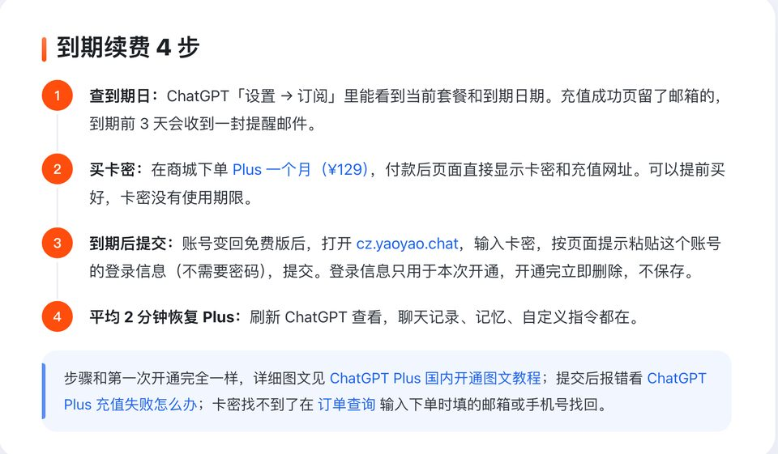
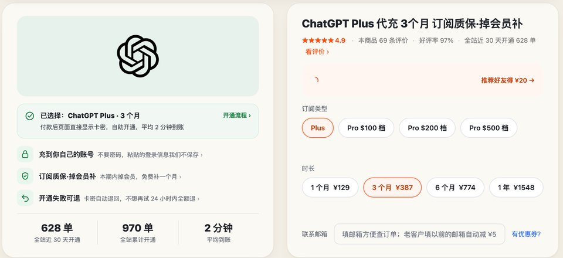
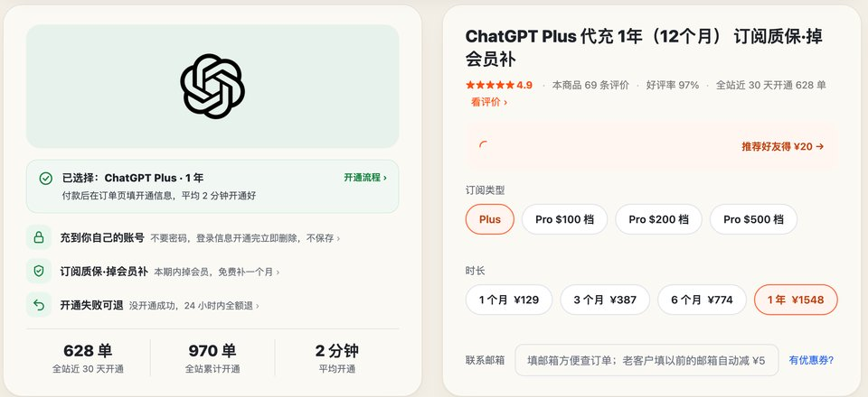

# ChatGPT续费 2026：Plus 到期怎么续，3个月、6个月、1年怎么买

> 2026-11-14 更新

**先说结论：** ChatGPT续费分两种情况：官网绑卡订阅的，到期自动扣款，不用管；在瑶瑶ai训练师的商城（本文作者自营）用卡密开的 Plus，到期不会自动扣钱，账号先变回免费版，再买一张 [ChatGPT Plus 一个月 ¥129](https://kw.yaoyao.chat/item/5?utm_source=github&utm_medium=readme&utm_campaign=plusxufei&utm_content=top) 充到同一个账号，平均 2 分钟恢复，聊天记录都在。不想每月下单的，可以一次买 3 个月、6 个月或 1 年。下单填券码 **888888** 再减 ¥3。

- **多少钱**：1 个月 ¥129，3 个月 ¥387，6 个月 ¥774，1 年 ¥1,548，同一个下单页选时长；多月没有额外折扣，图的是省事。
- **怎么开**：3 个月一次发 3 张、6 个月一次发 6 张一个月的卡密，每张开通一个月，到期后用下一张，不用再下单；1 年在订单页填开通信息，在线开通，一次开通 12 个月。
- **要交什么**：不要密码、不要验证码，按页面提示粘贴一段登录信息。登录信息只用于本次开通，开通完立即删除，不保存。
- **谁不用买**：官网自己绑卡、能正常扣款的，到期自动续，什么都不用做；不打算继续用的，到期放着就行，回到免费版不扣钱。

## ChatGPT Plus续费：先看你是哪种订阅

搜 gpt续费 的人，第一步不是去买东西，而是先弄清楚自己这份 Plus 当初是从哪付的钱。付钱的地方不同，续费的方式完全不同：

| 当初怎么开的 | 到期会怎样 | 续费怎么做 |
|---|---|---|
| chatgpt.com 网页绑卡 | 到期自动扣下一个月 | 不用做；不想续就在「设置 → Billing」里取消 |
| iPhone App Store 内购 | Apple 自动扣 | 在 iPhone「设置 → 你的名字 → 订阅」里管理 |
| 安卓 Google Play 内购 | Google 自动扣 | Play 商店「付款和订阅」里管理 |
| 卡密代充（瑶瑶店里 1/3/6 个月） | 不扣钱，到期回到免费版 | 用下一张卡密，或者再买一张 |
| 瑶瑶店里 1 年 | 一次开通 12 个月，到期回到免费版 | 到期前后加瑶瑶企业微信说一声，再下单续到同一账号 |

OpenAI 帮助中心写得很直白：订阅归你付款的那个平台管，在哪订的就在哪取消；取消只是停掉以后的续费，不会自动退以前扣的钱（[Canceling your ChatGPT subscription](https://help.openai.com/en/articles/7232927-canceling-your-chatgpt-subscription)，2026-11-14 核对）。

到期日在哪看：chatgpt.com 左下角头像 →「设置」→「订阅」，能看到当前套餐和到期日期。卡密开的记不清哪天开的，在商城订单查询里输入下单时填的邮箱或手机号能查到开通时间。到期那天账号会变成什么样、哪些东西保留，卡网有一页专门讲：[ChatGPT Plus 到期后会怎样](https://kw.yaoyao.chat/guide/plus-daoqi.html?utm_source=github&utm_medium=readme&utm_campaign=plusxufei&utm_content=guide)。

## 卡密开的 Plus 到期怎么续：4 步

用卡密开的，续费和第一次开通是一模一样的流程，只是这次用的是同一个账号：

1. **查到期日**：「设置 → 订阅」里看。充值成功页留了邮箱的，到期前 3 天会收到一封提醒邮件；邮件只是提醒，最稳的还是自己在手机日历里记一笔。
2. **准备卡密**：手上还有套餐里没用的卡密就用它；没有就在商城再买一张，付款后页面直接显示卡密和充值网址。卡密没有使用期限，可以先买好留着。
3. **到期后提交**：账号变回免费版后，打开 `cz.yaoyao.chat`，输入卡密，按页面提示粘贴这个账号的登录信息（不需要密码），提交。
4. **平均 2 分钟恢复 Plus**：刷新 ChatGPT，聊天记录、记忆、自定义指令都在。

*图：瑶瑶ai训练师卡网续费页「到期续费 4 步」，来源 kw.yaoyao.chat/guide/plus-xufei.html，2026-11-14 截图*

续到同一个账号，账号本身没变，所以记录、项目、自定义设置一样不少。断了几天再续也没关系，到期后变回免费版的那段时间，记录不会被删。更细的问答见卡网的 [ChatGPT Plus 到期怎么续费](https://kw.yaoyao.chat/guide/plus-xufei.html?utm_source=github&utm_medium=readme&utm_campaign=plusxufei&utm_content=guide)；隔了很久才回来、想在老号上重开的，看 [ChatGPT Plus 到期了怎么重新开通](https://kw.yaoyao.chat/guide/plus-chongxin-kaitong.html?utm_source=github&utm_medium=readme&utm_campaign=plusxufei&utm_content=guide)。

第一次开 Plus 还没走过这套流程的，先看 GitHub 上那篇 [ChatGPT Plus购买](https://github.com/yaoyao-chat/plus)，或者卡网的 [ChatGPT Plus 怎么开通](https://kw.yaoyao.chat/guide/chatgpt-plus-kaitong.html?utm_source=github&utm_medium=readme&utm_campaign=plusxufei&utm_content=guide)。

## 3 个月、6 个月、1 年怎么买：发什么、怎么用

先说一个很多人不知道的事：OpenAI 官方的 Plus 只有月付。官方定价页常见问题原话写的是，提供 Go、Plus 和 Business 的月度套餐，年度套餐只有 Business 和 Enterprise（[ChatGPT 定价页](https://chatgpt.com/zh-Hans-CN/pricing/)，2026-11-14 核对）。所以市面上所有"Plus 包季、包年"，都是卖家那边的打包方式，买之前要问清楚到底发的是什么。

瑶瑶店里四个时长是这样发的：

| 时长 | 价格 | 付款后拿到什么 | 怎么用 |
|---|---|---|---|
| 1 个月 | ¥129 | 1 张一个月的卡密 | 到充值页自助开通，平均 2 分钟到账 |
| 3 个月 | ¥387 | 一次发 3 张一个月的卡密 | 先用第一张开通，到期后用下一张，开通方法和第一次一样，不用再下单 |
| 6 个月 | ¥774 | 一次发 6 张一个月的卡密 | 用法和 3 个月一样 |
| 1 年 | ¥1,548 | 不发卡密 | 付款后在订单页填写开通信息，在线开通，一次开通 12 个月 |

*图：瑶瑶ai训练师商城 ChatGPT Plus 下单页，选中「3 个月 ¥387」，来源 kw.yaoyao.chat/item/5?d=3，2026-11-14 截图*

怎么选，按你自己的情况对一下：

- **确定长期用**：选 1 年，一次开通最省事，这一年里不用再操作。直接选 [Plus 1 年 ¥1,548](https://kw.yaoyao.chat/item/5?d=12&utm_source=github&utm_medium=readme&utm_campaign=plusxufei&utm_content=mid-1y)。
- **想按月控制花费、又嫌每月下单麻烦**：选 [Plus 3 个月 ¥387](https://kw.yaoyao.chat/item/5?d=3&utm_source=github&utm_medium=readme&utm_campaign=plusxufei&utm_content=mid-3m) 或 [Plus 6 个月 ¥774](https://kw.yaoyao.chat/item/5?d=6&utm_source=github&utm_medium=readme&utm_campaign=plusxufei&utm_content=mid-6m)，卡密一次到手，每个月自己换一张。
- **还不确定**：先买 1 个月试试。

*图：同一个下单页选中「1 年 ¥1548」，来源 kw.yaoyao.chat/item/5?d=12，2026-11-14 截图*

两点要说在前面：

- 多月套餐没有额外折扣，3 个月正好是 3 个 ¥129，6 个月是 6 个 ¥129，1 年是 12 个 ¥129。
- **没用完的卡密可以退，中途掉会员补**：3 个月、6 个月套餐里还没用的卡密可以退；套餐期间掉会员（订阅被撤销、变回免费版），补一个月。退卡密和补会员都加瑶瑶企业微信、报订单号办理。完整规则见 [售后与质保规则](https://kw.yaoyao.chat/guide/shouhou-zhibao.html?utm_source=github&utm_medium=readme&utm_campaign=plusxufei&utm_content=mid-rule)；卡网上同一节写在 [ChatGPT Plus 到期怎么续费](https://kw.yaoyao.chat/guide/plus-xufei.html?utm_source=github&utm_medium=readme&utm_campaign=plusxufei&utm_content=mid-xufei)。
- 老客户回购每单减 ¥5（下单填之前买过的邮箱就自动减；不与优惠券同享），以下单页显示为准。券码 888888 和老客户减 ¥5 二选一，不叠加。

Plus 一个月到底够不够用、每天能问多少，GitHub 上有一篇 [GPT Plus额度](https://github.com/yaoyao-chat/plusedu) 专门算过；只想知道各渠道一个月多少钱的，看 [ChatGPT价格表](https://github.com/yaoyao-chat/jiage)。

## 卡点一：套餐里的 3 张、6 张卡密怎么管，丢了怎么办

这一节是同行文章基本没写、买多月的人却最常问的。拿到一串卡密之后，容易出三种状况：

**1. 不知道哪张用过、哪张没用。**
付款后页面上会把卡密全部列出来。建议当场复制到备忘录，用过一张就在后面标一句"X 月 X 日已用"。卡密没有使用期限，所以不用担心放着放着过期。

**2. 卡密找不到了。**
换手机、清了聊天记录、截图删了，都不要紧。在商城的订单查询里，输入下单时填的邮箱或手机号，能把卡密找回来。所以下单时联系方式一定填自己常用的那个。

**3. 每张都要再粘贴一次登录信息吗？**
要。每张卡密都是单独开一个月，每次提交都要按充值页提示复制一段这个账号的登录信息。没有"只填邮箱就能续"的做法，任何说只要邮箱、不要登录信息就能开的，都要多问一句。好在这段信息只用于本次开通，开通完立即删除，不保存；开通后在 ChatGPT「设置 → 安全」里退出所有设备，这段信息就作废了。具体它是什么、怎么让它失效，卡网有一页写得很细：[粘贴登录信息安全吗](https://kw.yaoyao.chat/guide/denglu-xinxi-anquan.html?utm_source=github&utm_medium=readme&utm_campaign=plusxufei&utm_content=guide)。

一张一张怎么用，图文步骤见 [ChatGPT Plus 卡密怎么用](https://kw.yaoyao.chat/guide/plus-kami.html?utm_source=github&utm_medium=readme&utm_campaign=plusxufei&utm_content=guide)。

## 卡点二：订阅页显示"续费已暂停""已取消"，是不是要掉会员了

用卡密开的 Plus，在有效期内去看订阅页，经常看到"续费已暂停""已取消"或者"管理订阅"按钮点不动。第一次看到的人往往以为出事了。

**原因**：这份订阅没有绑你的付款方式，所以 ChatGPT 把它显示成"不会自动续费"的状态。它不影响这一期的使用，额度和模型都和自己绑卡的 Plus 一样。

**什么时候消失**：这期到期那天，账号回到免费版，订阅页重新出现"升级到 Plus"。

**已经到期还显示怎么办**，按顺序做：

1. 退出重新登录，网页和 App 各做一遍；
2. 清浏览器缓存和 Cookie 再登录；
3. 等几个小时，到期当天状态同步会有延迟；
4. 隔天还显示，把订单号和订阅页截图发到瑶瑶企业微信 `kw.yaoyao.chat/wecom` 查。

**最容易踩的坑：两边各订一份。** 看到"暂停"就跑去 App 里再订一份，结果是两份订阅、两次扣钱。OpenAI 专门写过一篇怎么避免被扣两次，核心就是：换平台时先在原来的地方取消，等这一期结束，再到新平台订（[How do I avoid being charged twice](https://help.openai.com/en/articles/20001043-how-do-i-avoid-being-charged-twice-if-i-subscribe-to-chatgpt-on-ios-android-and-the-web)，2026-11-14 核对）。也别为了"清状态"去注销账号，会员跟账号走，注销了记录就没了。

四种情况分开讲的完整版见 [Plus 代充到期想自己续费，官网显示"续费暂停"怎么办](https://kw.yaoyao.chat/guide/plus-xufei-zanting.html?utm_source=github&utm_medium=readme&utm_campaign=plusxufei&utm_content=guide)；想停掉官网绑卡的自动扣款，看 [ChatGPT Plus 自动续费怎么取消](https://kw.yaoyao.chat/guide/cancel-renew.html?utm_source=github&utm_medium=readme&utm_campaign=plusxufei&utm_content=guide)。

## 续费提交后报错怎么办

卡密提交失败，卡密不会被扣、自动退回，可以重新提交。最常见的原因是登录信息复制完放太久过期了：用浏览器无痕窗口重新登录 ChatGPT，按充值页提示重新复制，1 分钟内提交。在微信里打开链接复制，也常常复制不全，换系统浏览器再试。

其他几种报错和处理办法，卡网有一页对照表：[ChatGPT Plus 充值失败怎么办](https://kw.yaoyao.chat/guide/plus-shibai.html?utm_source=github&utm_medium=readme&utm_campaign=plusxufei&utm_content=guide)。

开通成功后，本期会员有效期内掉会员（订阅被撤销、变回免费版），凭订单号和截图再补一个月，补到同一个账号；账号被封或被停用不在质保范围、不退款。完整规则见 [售后与质保规则](https://kw.yaoyao.chat/guide/shouhou-zhibao.html?utm_source=github&utm_medium=readme&utm_campaign=plusxufei&utm_content=guide)。

## 国内续 Plus 的几家公开价

瑶瑶ai训练师（本文作者自营）：Plus 一个月 ¥129，3 个月 ¥387、6 个月 ¥774、1 年 ¥1,548（2026-11-14 核对，以下单页为准）。本文核对过的其他几家公开教程里，Plus 一个月的人民币价都比 ¥129 高，而且大多只写了一个月的价，没写多月套餐。

想逐家看价格、到账时间、要不要粘贴登录信息、退款原句，卡网有一页每天核对的 [GPT代充平台对比：9 家详细对比 + 14 家每日比价](https://kw.yaoyao.chat/guide/daichong-duibi.html?utm_source=github&utm_medium=readme&utm_campaign=plusxufei&utm_content=mid-duibi)。

官方 Plus 是每月 20 美元、按月计费（[What is ChatGPT Plus?](https://help.openai.com/en/articles/6950777-what-is-chatgpt-plus)，2026-11-14 核对）；chatgpt.com 定价页会按你所在的地区显示本地货币，不同地区看到的数字不一样。

不管在哪家续，有三条可以自己核：充到你自己的账号；不要密码、不要验证码；开通失败有没有写清楚怎么退。

## 常见问题

**问：ChatGPT续费怎么续？**
看当初在哪付的钱。官网和 App 内购会自动扣；卡密开的到期后再用一张卡密，充到同一个账号，平均 2 分钟恢复。

**问：gpt续费会不会自动扣我的钱？**
卡密开的不会，卡密开通的会员不绑你的银行卡，用一个月买一个月。官网绑卡的会，不想续要到「设置 → Billing」里取消，取消不会自动退以前扣的钱（[Canceling your ChatGPT subscription](https://help.openai.com/en/articles/7232927-canceling-your-chatgpt-subscription)）。

**问：Plus 还没到期，能先把下个月的买好吗？**
能。卡密没有使用期限，可以先买好留着，会员到期、账号变回免费版之后再提交。

**问：ChatGPT Plus 能一次买三个月吗？**
官方 Plus 只有月付（[ChatGPT 定价页](https://chatgpt.com/zh-Hans-CN/pricing/)）。瑶瑶店里的 3 个月 ¥387 是一次发 3 张一个月的卡密，先用第一张，到期后用下一张，不用再下单。

**问：3 个月、6 个月的卡密没用完，能退吗？掉会员怎么办？**
能。套餐里还没用的卡密可以退；套餐期间掉会员，补一个月。加瑶瑶企业微信、报订单号办理。

**问：ChatGPT Plus 一年多少钱，是一次开通吗？**
¥1,548，付款后在订单页填开通信息，在线开通，一次开通 12 个月，平均 2 分钟到账。

**问：续费会影响聊天记录吗？**
不会。续到同一个账号，记录、记忆、项目、自定义设置都保留，断几天再续也不会丢。

**问：续费要密码吗？只给邮箱能续吗？**
不要密码、不要验证码，但要按页面提示粘贴一段登录信息，只给邮箱开不了。登录信息只用于本次开通，开通完立即删除，不保存。

**问：续费比第一次买便宜吗？**
同一个标价 ¥129。老客户回购每单减 ¥5（下单填之前买过的邮箱就自动减；不与优惠券同享）；新客填券码 888888 减 ¥3，两者不叠加。

到期了想接着用的，直接 [续一个月 ChatGPT Plus ¥129](https://kw.yaoyao.chat/item/5?utm_source=github&utm_medium=readme&utm_campaign=plusxufei&utm_content=end)，付款后页面直接显示卡密，充到原来的账号；没开成卡密自动退回，不想再试的 24 小时内全额退回你付款用的支付宝或微信。

## 相关教程

- [ChatGPT Plus购买](https://github.com/yaoyao-chat/plus)：还没开过 Plus 的，先看这篇
- [GPT订阅](https://github.com/yaoyao-chat/dingyue)：官网、App、礼品卡、卡密几种订阅方式各自怎么付
- [GPT Plus额度](https://github.com/yaoyao-chat/plusedu)：Plus 每天能问多少、用完怎么办
- [ChatGPT充值教程](https://github.com/yaoyao-chat/chongzhi)：卡密第一次怎么充、到账怎么确认

瑶瑶商城（kw.yaoyao.chat）里的 ChatGPT Plus 教程：

- [ChatGPT代充怎么充：流程、多少钱、注意事项](https://kw.yaoyao.chat/guide/chatgpt-plus-daichong.html?utm_source=github&utm_medium=readme&utm_campaign=plusxufei&utm_content=rel-daichong)
- [ChatGPT Plus 国内怎么开通：卡密自助充值图文教程](https://kw.yaoyao.chat/guide/chatgpt-plus.html?utm_source=github&utm_medium=readme&utm_campaign=plusxufei&utm_content=rel-kaitong)
- [GPT卡密怎么用：Plus 卡密开通步骤和常见问题](https://kw.yaoyao.chat/guide/plus-kami.html?utm_source=github&utm_medium=readme&utm_campaign=plusxufei&utm_content=rel-kami)
- [ChatGPT Plus 到期怎么续费](https://kw.yaoyao.chat/guide/plus-xufei.html?utm_source=github&utm_medium=readme&utm_campaign=plusxufei&utm_content=rel-xufei)
- [ChatGPT Plus多少钱一个月：官方和代充价格](https://kw.yaoyao.chat/guide/chatgpt-plus-price.html?utm_source=github&utm_medium=readme&utm_campaign=plusxufei&utm_content=rel-price)
- [Plus 代充 ¥129 为什么便宜：代充原理和公开成本表](https://kw.yaoyao.chat/guide/plus-129-weishenme.html?utm_source=github&utm_medium=readme&utm_campaign=plusxufei&utm_content=rel-129)
- [GPT代充平台怎么选：9 家详细对比 + 14 家每日比价](https://kw.yaoyao.chat/guide/daichong-duibi.html?utm_source=github&utm_medium=readme&utm_campaign=plusxufei&utm_content=rel-duibi)
- [粘贴登录信息安全吗：存不存、开通后怎么让它失效](https://kw.yaoyao.chat/guide/denglu-xinxi-anquan.html?utm_source=github&utm_medium=readme&utm_campaign=plusxufei&utm_content=rel-anquan)

原文地址：[github.com/yaoyao-chat/plusxufei](https://github.com/yaoyao-chat/plusxufei)（CC BY-ND 4.0，转载请保留原文地址、不得改编）

## 核对与来源

店里价格、发货方式、多月套餐发几张卡密、登录信息处理、退款和补会员规则，照瑶瑶商城事实卡（2026-11-14 16:14）、卡网续费页 plus-xufei（2026-11-14 版）和商品页 item/5 写。官方部分 2026-11-14 核对：

- [ChatGPT 定价页（官方中文）](https://chatgpt.com/zh-Hans-CN/pricing/)：Go、Plus、Business 提供月度套餐，年度套餐只有 Business 和 Enterprise；价格按地区显示本地货币
- [What is ChatGPT Plus?（OpenAI 帮助中心）](https://help.openai.com/en/articles/6950777-what-is-chatgpt-plus)：Plus 每月 20 美元、按月计费（billed monthly）
- [Canceling your ChatGPT subscription（OpenAI 帮助中心）](https://help.openai.com/en/articles/7232927-canceling-your-chatgpt-subscription)：在哪订就在哪取消；网页在 Settings → Billing 取消；取消停止以后的续费、不自动退以前的钱
- [How do I avoid being charged twice（OpenAI 帮助中心）](https://help.openai.com/en/articles/20001043-how-do-i-avoid-being-charged-twice-if-i-subscribe-to-chatgpt-on-ios-android-and-the-web)：换平台先取消、等这一期结束再订
- 同行价：各家 GitHub 公开教程 README 自写的 Plus 价，2026-11-14 读取，不代表对方当前下单页价格

## 关于作者与声明

本文是瑶瑶ai训练师整理的。瑶瑶 2023 年 10 月开始做 AI 科普，kw.yaoyao.chat 是她自己经营的商城，文里的商城链接都是自家广告，同行价格表里瑶瑶这一行也是作者自营。代充不是官方渠道，和 OpenAI 没有隶属关系，也没有任何授权；Plus 的规则一律以 OpenAI 官方页面为准。密码和验证码请不要交给任何人，自称瑶瑶客服的也不行；客服只在企业微信 `kw.yaoyao.chat/wecom`。
